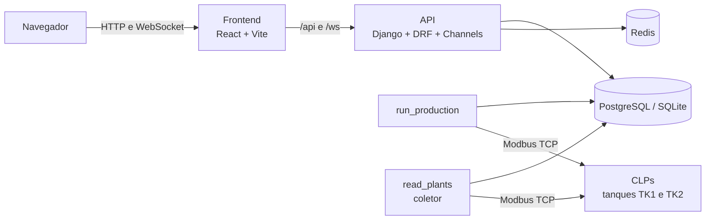

# FluidMES

**Sistema MES (Manufacturing Execution System) para plantas de processos industriais**, com tanques TK1 e TK2 controlados por CLP via Modbus TCP. Desenvolvido como projeto de conclusão de curso do SENAI.

O sistema acompanha plantas, CLPs e sensores em tempo real, planeja a produção por ciclos, executa a receita direto no equipamento (ou por simulação, quando não há CLP) e calcula o rendimento (OEE).

## O que o sistema faz

- **Telemetria ao vivo** de plantas, CLPs e sensores, com controle dos tanques TK1/TK2.
- **Planejamento por ciclos:** reparte os pedidos entre os tanques conforme capacidade e disponibilidade.
- **Execução pelo CLP:** grava a receita nos registradores, aciona o ciclo e acompanha o status. Sem CLP, roda uma simulação por tempo.
- **Pedidos e receitas** com aprovação, receitas de dois ou três ingredientes, paradas e rendimento (OEE).
- **Acesso por cargo** (Preposto, Chefe e Funcionário), com preferências por conta e trilha de auditoria.

## Como as partes se conectam



## Estrutura do repositório

| Pasta | Conteúdo | Documentação |
| --- | --- | --- |
| [`backend/`](backend) | API Django/DRF, WebSockets, coleta Modbus, produção e OEE | [`backend/README.md`](backend/README.md) |
| [`frontend/`](frontend) | Interface React/Vite, com guia de design (cores e tipografia) | [`frontend/README.md`](frontend/README.md) |
| [`.github/workflows/`](.github/workflows) | CI dos dois projetos | |

## Tecnologias

| Camada | Principais ferramentas |
| --- | --- |
| Backend | Python 3.12, Django 5.2, Django REST Framework, Channels, Celery, pymodbus |
| Dados | PostgreSQL em produção, SQLite em desenvolvimento, Redis |
| Frontend | React 19, React Router 7, Vite 6, Bootstrap 5, Axios |
| Infra | Docker, nginx, GitHub Actions, Vercel |

## Início rápido

Requisitos: Python 3.12 e Node.js 22+.

```bash
# terminal 1: API
cd backend && python -m venv .venv && source .venv/bin/activate
pip install -r requirements.txt && python manage.py migrate
python -m uvicorn config.asgi:application --host 127.0.0.1 --port 8000

# terminal 2: execução dos pedidos
cd backend && source .venv/bin/activate && python manage.py run_production

# terminal 3: interface (http://localhost:5173)
cd frontend && npm ci && npm run dev
```

No Windows, ative o ambiente com `.venv\Scripts\activate`.

Para criar um usuário administrador, rode `python manage.py createsuperuser` dentro de `backend/`. Sem CLP real, o sistema usa a simulação por tempo, e o `backend/README.md` explica como subir um CLP simulado para testar o Modbus.

## Docker

Cada projeto tem o próprio `compose.yaml`:

```bash
cd backend  && docker compose up --build   # API em http://127.0.0.1:8000
cd frontend && docker compose up --build   # interface em http://127.0.0.1:8080
```

Detalhes e variáveis de ambiente estão nos READMEs de cada pasta.

## Qualidade

O workflow [`ci.yml`](.github/workflows/ci.yml) roda a cada push e pull request:

- **backend:** `manage.py check`, verificação de migrações e testes dos apps `accounts`, `plantas` e `producao`;
- **frontend:** lint, build e testes de alinhamento de seções da landing.

## Versão

Versão atual: **1.3.0**, a primeira lançada. Veja a aba [Releases](../../releases).
